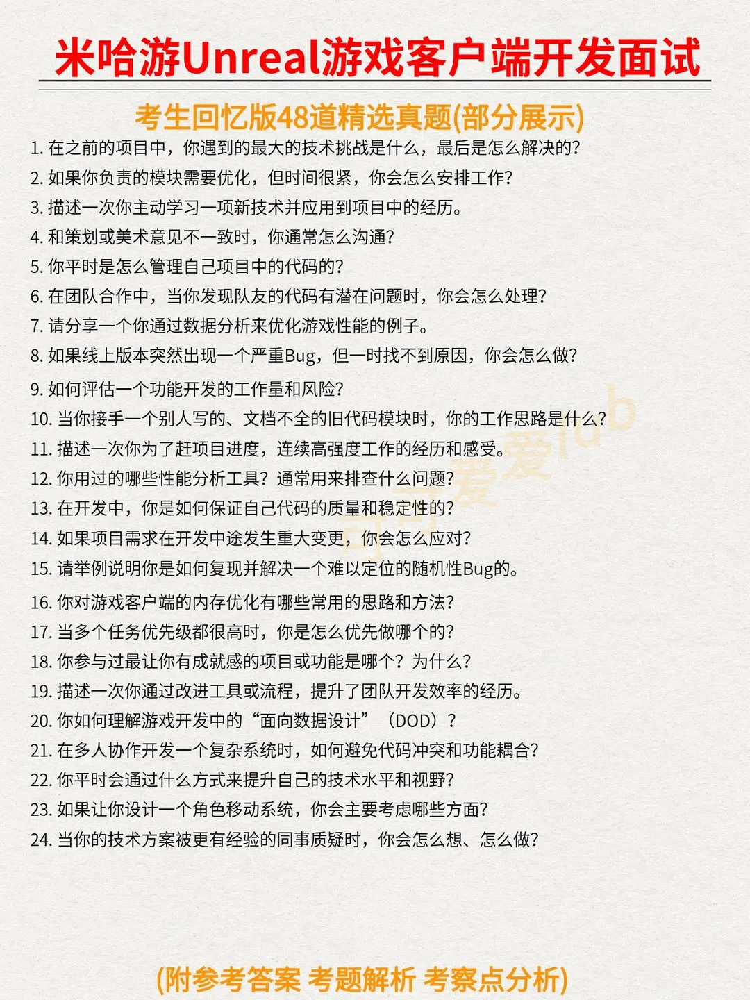
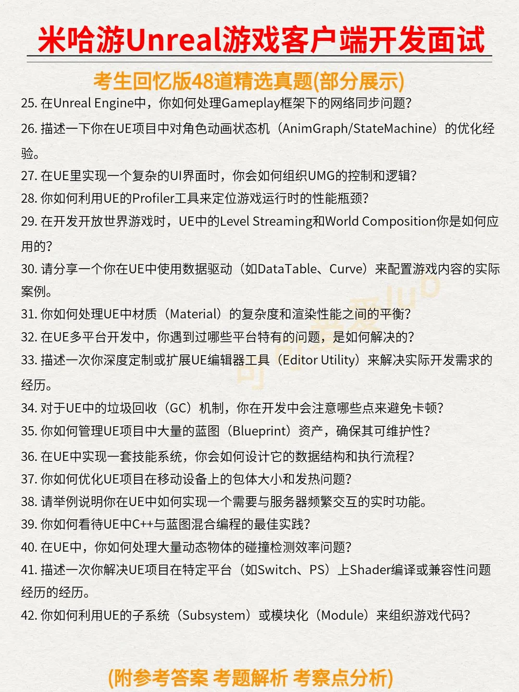
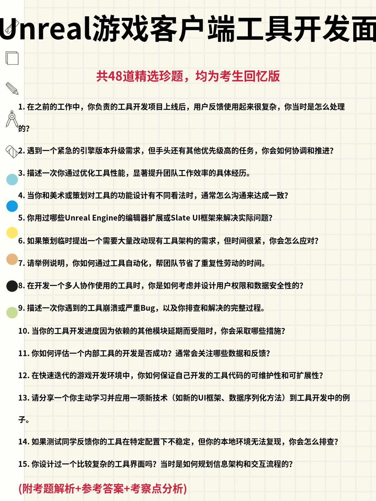
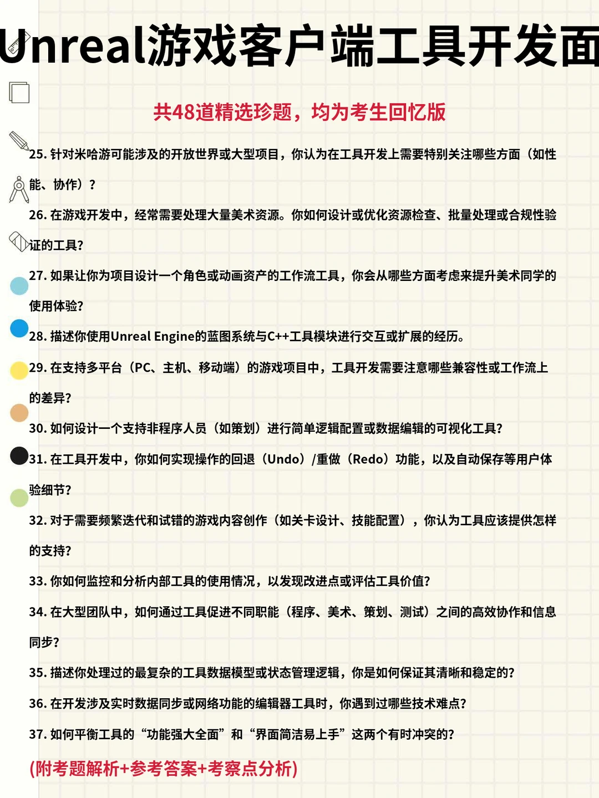

米哈游游戏客户端开发实习一面面经
米哈游游戏客户端开发一面，第一次收到老米的面试，大概45分钟，八股狠狠拷打
1. 自我介绍，详细问了个c++的项目，问了下为啥简历算法多要投游戏客户端
2.开始八股拷打 指针和引用的区别是什么？
3. 面向对象的三大特性是什么？
4. 什么是多态？多态的实现原理是什么？
5. 虚函数表是怎么工作的？
6. 为什么析构函数一般要写成虚函数？
7. 构造函数可以是虚函数吗？为什么？虚函数会带来什么开销
8.虚继承解决了什么问题？
9. 菱形继承是什么？怎么解决？
10. 堆和栈的区别是什么 什么情况下会发生内存泄漏
11. 左值、右值、将亡值分别是什么，什么是右值引用有什么作用？
12. 进程和线程的区别是什么，为什么线程切换通常比进程切换更快，线程共享进程中的哪些资源？哪些资源不共享？多线程和多进程各自适合什么场景，进程间通信有哪些方式
13. 是否有负责过完整的网络协议或高并发项目的经验？在游戏开发中我们使用UDP协议较多，能否谈谈你的相关经验
14. TCP和UDP区别 为什么游戏用UDP，优缺点是什么，
如果游戏要保证所有输入数据都确保对端收到，怎么保证
手撕：一个整型数组已知数组里除了一个数字之外，其他的数字都出现了两次，找出这个只出现一次的数字
异或秒了，追问如果是两个只出现一次的数字怎么找两个，再追问三个怎么办，说了哈希表然后问不用库的方法，就说了排序
八股问题应该还没写全，剩下记不得了，真的超高强度八股拷打，反问了一下看重的能力，说实习生就是看重基础知识，进去项目组会慢慢学所以问八股多
然后问了下实习生进什么组说会尊重意愿面完感觉力竭了#米哈游#面试#暑期实习#offer
更新：约二面了挺速度的

Unreal游戏客户端开发工程师：常见问题与回
Unreal游戏客户端开发工程师面试真的好卷。。总结了网友分享的Unreal游戏客户端开发工程师重点面试题：
	
Unreal游戏客户端开发工程师面试高频题整理
	
【战斗系统开发篇】
1. GE的三种持续时间类型分别有什么区别？
2. 设计一套技能系统的标签层级时，你通常怎么分类？
3. 简单聊聊 GAS 的 Prediction Key 是如何工作的？
4. NavLinkProxy 是做什么用的？它和普通寻路有什么区别？
5. 如何优化大量NPC同屏时的动画系统开销？
	
【渲染管线原理篇】
6. 在UE中开启前向渲染后，半透明物体的渲染表现会有什么变化？
7. 延迟渲染是如何解决前向渲染“光源爆炸”问题的？
8. 光照探针为什么常用球谐函数（SH）来存储信息？
9. 反射捕获（Reflection Capture）的实现原理是什么，它如何处理粗糙度？
10. VSM 虽然效果好，但在开发中会有哪些性能坑点？
	
【游戏性能优化篇】
11. 通过 Stat Unit 看到 Frame 时间很高，你怎么判断是 CPU 还是 GPU 瓶颈？
12. 简单聊聊什么是 DrawCall，为什么它会成为性能瓶颈？
13. 实例化渲染（Instancing）的原理是什么？它主要解决了什么瓶颈？
14. 虚幻引擎中 Pak 文件的挂载机制和搜索优先级是怎样的？
15. InvalidationBox 的核心原理是什么？它是怎么减少开销的？
	
【UE引擎架构篇】
16. UCLASS 里的 Meta 标签有什么用？能举个具体的例子吗？
17. 如何通过 Build.cs 控制不同平台的第三方库加载？
18. ActorComponent 和 SceneComponent 的核心区别是什么？
19. UE里如何判断一个 Actor 的所有权？它的主要作用是什么？
20. AnimInstance 中的 NativeUpdateAnimation 和 BlueprintUpdateAnimation 有什么区别

米哈游一面凉经
C++里的多态指的是什么（我说分为编译时多态和运行时多态，然后面试官让写个代码示例）
重写和覆盖区别
虚函数
虚函数和纯虚函数的区别
哈希表是什么
哈希表中的键值能否是一个实例化的对象，需要满足哪些要求

